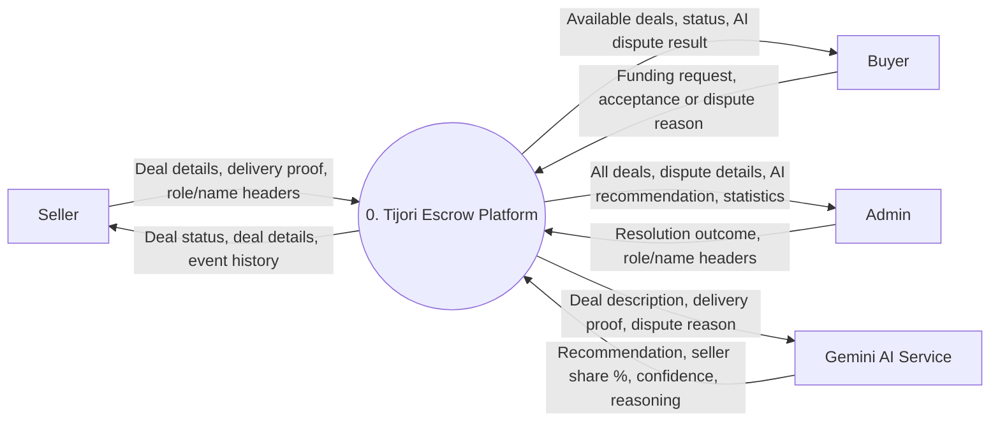
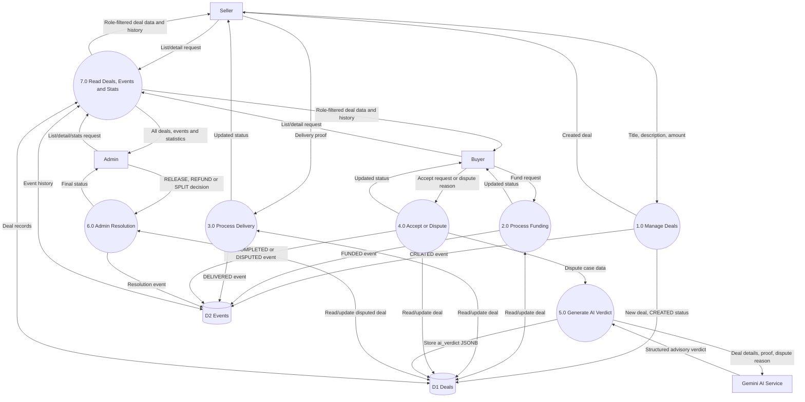

# Data Flow Diagram (DFD) — Tijori

## 1. System overview

Tijori is a demo escrow workflow for freelance deals. A seller creates a deal, a buyer
funds it (simulated/demo flow), the seller submits delivery proof, and the buyer either
accepts the delivery or raises a dispute. For disputes, the backend requests an advisory
verdict from the Gemini AI service; an admin makes the final resolution decision.

> **Important:** This DFD describes the software workflow. It does not imply that the
> application currently transfers or holds real money.

## 2. DFD Level 0 — Context Diagram

### External entities

| Entity | Responsibility |
|---|---|
| Seller | Creates deals and submits delivery proof for their own deals |
| Buyer | Views available deals, funds a deal, then accepts delivery or raises a dispute |
| Admin | Views all deals/statistics and resolves disputed deals |
| Gemini AI Service | Returns an advisory release/refund/split recommendation for a dispute |

## 3. DFD Level 1 — Main Processes and Data Stores

## 4. Process descriptions

| Process | Input | Processing | Output |
|---|---|---|---|
| 1.0 Manage Deals | Seller's title, description and integer-rupee amount | Validates fields, creates UUID, inserts a deal in `CREATED` state | Deal record and initial event |
| 2.0 Process Funding | Buyer funding request | Checks buyer role and `CREATED` state; records buyer name and changes state | `FUNDED` deal and event |
| 3.0 Process Delivery | Seller's delivery proof | Checks seller ownership and `FUNDED` state; stores proof | `DELIVERED` deal and event |
| 4.0 Accept or Dispute | Buyer acceptance or dispute reason | Checks buyer ownership and `DELIVERED` state | `COMPLETED` or `DISPUTED` deal and event |
| 5.0 Generate AI Verdict | Deal details, delivery proof and dispute reason | Calls Gemini and validates structured recommendation | Optional verdict stored in `deals.ai_verdict` |
| 6.0 Admin Resolution | Admin's `RELEASE`, `REFUND` or `SPLIT` outcome | Validates disputed state and split percentage; updates final status | Resolved deal and event |
| 7.0 Read Deals, Events and Stats | Role-specific list/detail/statistics request | Applies role-based visibility and reads persistent records | Deal data, event history or aggregate statistics |

## 5. Data stores

- **D1 — Deals:** Core deal details, participants' names, amount, current status, delivery
  proof, dispute reason, optional AI verdict, and creation timestamp.
- **D2 — Events:** Append-style history of deal state transitions, including actor role/name,
  previous and next status, note, and timestamp.

## 6. Business rules represented

1. Valid lifecycle: `CREATED → FUNDED → DELIVERED → COMPLETED` or
   `DELIVERED → DISPUTED → RESOLVED_*`.
2. Only the seller who created a deal can submit its delivery proof.
3. Only the buyer associated with a funded deal can accept or dispute it.
4. Only an admin can resolve a disputed deal.
5. Every state transition is recorded in `events`; creation also writes an initial event.
6. A state update and its event insert are committed in one database transaction.
7. Amounts are integer rupees; the demo does not use floating-point money values.
8. AI output is advisory; the admin supplies the final resolution outcome.
9. If the AI service fails or returns invalid output, the dispute can still be recorded;
   `ai_verdict` may remain `NULL`.

## 7. Scope limitations

The current schema does not include a payment transaction table, wallet table, bank/UPI
integration, stored user accounts, or a separate AI-verdict table. The DFD therefore does
not model those as implemented data stores or services.
