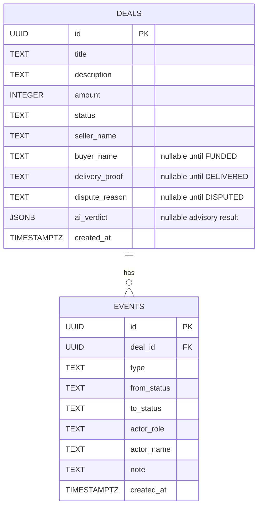

# Entity Relationship Diagram (ERD) — Tijori

## 1. Database overview

The current PostgreSQL schema contains two tables:

1. `deals` — one row per escrow deal.
2. `events` — a chronological record of actions/status transitions for a deal.

## 2. ERD



**Relationship:** One `deals` record can have zero or many `events` records. Each event belongs
to exactly one deal through `events.deal_id → deals.id`.

## 3. Entity definitions

### DEALS

| Attribute | Type | Key / constraint | Description |
|---|---|---|---|
| `id` | UUID | PK | Application-generated deal identifier |
| `title` | TEXT | NOT NULL | Deal title |
| `description` | TEXT | NOT NULL | Work/product description and agreed scope |
| `amount` | INTEGER | NOT NULL, CHECK > 0 | Deal amount in whole Indian rupees |
| `status` | TEXT | NOT NULL, CHECK allowed values | Current lifecycle state |
| `seller_name` | TEXT | NOT NULL | Seller name supplied by request header |
| `buyer_name` | TEXT | NULL allowed | Set when a buyer funds the deal |
| `delivery_proof` | TEXT | NULL allowed | Seller's proof of delivery |
| `dispute_reason` | TEXT | NULL allowed | Buyer's reason for raising a dispute |
| `ai_verdict` | JSONB | NULL allowed | AI recommendation, share percentage, confidence and reasoning |
| `created_at` | TIMESTAMPTZ | NOT NULL | Deal creation timestamp |

### EVENTS

| Attribute | Type | Key / constraint | Description |
|---|---|---|---|
| `id` | UUID | PK | Unique event identifier |
| `deal_id` | UUID | FK, NOT NULL | References `deals.id` |
| `type` | TEXT | NOT NULL, CHECK allowed values | Event type/status action |
| `from_status` | TEXT | NOT NULL | Status before the transition |
| `to_status` | TEXT | NOT NULL | Status after the transition |
| `actor_role` | TEXT | NOT NULL, CHECK seller/buyer/admin | Role that performed the action |
| `actor_name` | TEXT | NOT NULL | Name from request header |
| `note` | TEXT | NOT NULL | Human-readable event description |
| `created_at` | TIMESTAMPTZ | NOT NULL | Event timestamp |

## 4. Enumerated values

### `deals.status` and `events.type`

- `CREATED`
- `FUNDED`
- `DELIVERED`
- `COMPLETED`
- `DISPUTED`
- `RESOLVED_RELEASED`
- `RESOLVED_REFUNDED`
- `RESOLVED_SPLIT`

### `events.actor_role`

- `seller`
- `buyer`
- `admin`

### `deals.ai_verdict` JSONB shape

```json
{
  "recommendation": "RELEASE | REFUND | SPLIT",
  "sellerSharePercent": 0,
  "confidence": "LOW | MEDIUM | HIGH",
  "reasoning": "Short explanation for the admin"
}
```

Consistency constraints:

- `RELEASE` requires `sellerSharePercent = 100`.
- `REFUND` requires `sellerSharePercent = 0`.
- `SPLIT` requires `sellerSharePercent` from 1 through 99.

## 5. Relationship and cardinality

| Parent | Child | Cardinality | Explanation |
|---|---|---|---|
| `deals.id` | `events.deal_id` | 1 : 0..N | A deal may have multiple lifecycle events; an event cannot exist without its parent deal |

The initial deal-creation event is also stored in `events`. Its `from_status` and `to_status`
are both `CREATED`.

## 6. Important modelling decisions

- **No `USERS` table:** The current implementation identifies participants using `x-user-role`
  and `x-user-name` request headers. Names are stored directly in `deals` and `events`.
- **No `PAYMENTS` table:** Funding is a demo workflow state change; the repository README
  explicitly describes the project as having no real payments.
- **No separate `AI_VERDICTS` table:** The structured AI result is stored in the
  `deals.ai_verdict` JSONB column.
- **No separate `DISPUTES` table:** Dispute reason and AI verdict are columns on `deals`.
- **Event history:** Each lifecycle action writes an `events` row linked by `deal_id`.

## 7. Source of truth

The entity names, columns, data types, constraints, and foreign-key relationship follow
`backend/db.py` and the PostgreSQL schema in `CONTRACT.md`. The API lifecycle and role
rules follow `CONTRACT.md` and `backend/main.py`.
